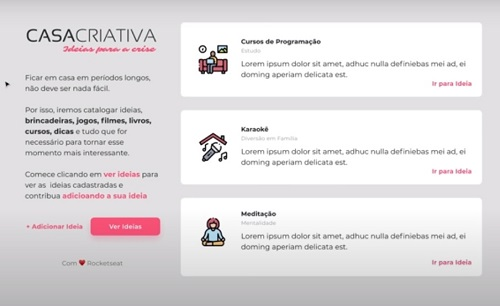

> **Projeto de estudo.** Estado conferido em 31/10/2026: os endereços que seguem fora do ar foram retirados deste README. Detalhes em [docs/AVALIACAO.md](docs/AVALIACAO.md) e próximos passos em [docs/PLANO-ESTRATEGICO.md](docs/PLANO-ESTRATEGICO.md).

<h1 align="center">Casa Criativa</h1>

<p align="center">Catálogo colaborativo de ideias de atividades para fazer em casa.</p>

<p align="center"></p>

## 🧠 O que aprendi

> Proposta de 01/11/2026, escrita a partir do código e das dependências. Ajuste com a sua experiência.

- Renderizar páginas no servidor com Express e Nunjucks.
- Guardar ideias em SQLite com `better-sqlite3`.
- Escapar conteúdo e aceitar somente links `http(s)`.
- Limitar envios e testar com `node --test`.

## Problema e proposta

Quem passa longos períodos em casa procura o que fazer. A Casa Criativa reúne ideias (cursos, brincadeiras, filmes, livros) cadastradas pela própria comunidade.

- **Público:** famílias e estudantes em casa.
- **Métrica de sucesso:** ideias cadastradas por semana (`GET /health` mostra o total).

## Funcionalidades

- Home com as 2 ideias mais recentes e lista completa em `/ideias`.
- Cadastro com validação no navegador e no servidor (erros por campo, foco no primeiro erro).
- Somente links `http(s)`; conteúdo escapado; limite de 10 envios por minuto.
- Páginas próprias para 404 e 500.

## Stack

Node 22 · Express 4 · Nunjucks · SQLite (better-sqlite3) · helmet · node:test + supertest.

## Como rodar

```sh
npm install
cp .env.example .env   # opcional
npm run dev            # http://localhost:3000
npm test               # 8 testes
```

Para reaproveitar as ideias do banco antigo, use `DATABASE_FILE=./ws.db` na primeira execução: a migration converte a tabela e descarta linhas inválidas.

## Publicação

- **Publicação:** Fora do ar desde a conferência de 31/10/2026; para ver o projeto, rode localmente (seção "Como rodar"). O `render.yaml` continua no repositório.
- GitHub Pages não serve aqui: o projeto tem servidor Express e banco SQLite, e o Pages só publica arquivos estáticos.
- O SQLite de produção fica em `/tmp/casa-criativa.sqlite`: as ideias cadastradas **somem a cada reinício ou deploy** e o banco volta às 2 ideias iniciais.
- Passo a passo completo: [docs/DEPLOY.md](docs/DEPLOY.md).

## Documentação

- [docs/ANALISE.md](docs/ANALISE.md) · [docs/ARQUITETURA.md](docs/ARQUITETURA.md) · [docs/PLANO-DE-ACAO.md](docs/PLANO-DE-ACAO.md) · [docs/DEPLOY.md](docs/DEPLOY.md)

Projeto iniciado no workshop Rocketseat (Mayk Brito) e evoluído por [@douglasabnovato](https://github.com/douglasabnovato).
