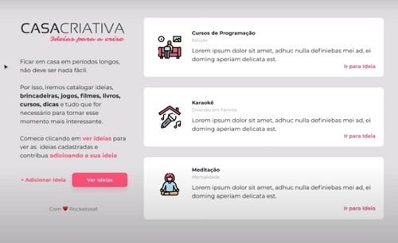

> **Projeto de estudo (N1).** Estado conferido em 16/11/2026: o link do Render não respondeu e ficou fora deste README. O estado atual está em "Estado e próximos passos", abaixo, e em [docs/MVP.md](docs/MVP.md).

<h1 align="center">Casa Criativa</h1>

<p align="center">Catálogo colaborativo de ideias de atividades para fazer em casa.</p>

<p align="center"></p>

## 🧠 O que aprendi

> Proposta de 01/11/2026, escrita a partir do código e das dependências. Ajuste com a sua experiência.

- Renderizar páginas no servidor com Express e Nunjucks.
- Guardar ideias em SQLite com `better-sqlite3`.
- Escapar conteúdo e aceitar somente links `http(s)`.
- Limitar envios e testar com `node --test`.

## Estado e próximos passos (ciclo de 16/11/2026)

Projeto de estudo (N1): 10 de 10 critérios aplicáveis atendidos. **Finalizado**: sim. A `master` está protegida (exige PR e os checks `raiz` e `interface`). O app não tem tema escuro próprio.

**O que foi feito**
- 06/11 (PRs #52 e #53): filtro por categoria, landmarks e ordem de títulos, teste da página 500, CI nos PRs para `developer/**`, arquivos legados removidos.
- 07/11 (PRs #54 e #57): testes de interface com Playwright no CI, cobrindo o cadastro pelo modal, o filtro, o erro de link e o teclado (#48); axe em `/`, `/ideias` e 404, com o modal aberto e com erros (#49); Tab preso dentro do modal aberto.
- 16/11 (PR #59): busca por texto em `/ideias` (#50); `better-sqlite3` 12 e testes também no Node 24 (#51); testes de interface em 375 px, sem rolagem horizontal (#55); `docs/DEPLOY.md` revisto. O projeto "escuro" do Playwright saiu: ele repetia a tela clara.

**O que queremos fazer**
- [#60](https://github.com/douglasabnovato/casa-criativa/issues/60) Paginar a lista de ideias (hoje corta em 100).
- [#61](https://github.com/douglasabnovato/casa-criativa/issues/61) Migrar para Express 5 e `express-rate-limit` 8.
- [#62](https://github.com/douglasabnovato/casa-criativa/issues/62) Buscar sem diferenciar acentos.
- [#63](https://github.com/douglasabnovato/casa-criativa/issues/63) Decidir se o `ws.db` fica no repositório.
- [#64](https://github.com/douglasabnovato/casa-criativa/issues/64) Mesclar o ciclo de 16/11 na `master` (responsável).
- [#47](https://github.com/douglasabnovato/casa-criativa/issues/47) Decidir a publicação: o link do Render não respondeu em 16/11 (responsável).

**Onde está a documentação**
- [docs/MVP.md](docs/MVP.md): critérios, evidências e estado.
- [docs/PLANO-DE-ACAO.md](docs/PLANO-DE-ACAO.md): seção "Ciclo de 16/11/2026", com pesquisa, backlog e engenharia.
- [docs/DEPLOY.md](docs/DEPLOY.md): passo a passo da publicação no Render.

## Problema e proposta

Quem passa longos períodos em casa procura o que fazer. A Casa Criativa reúne ideias (cursos, brincadeiras, filmes, livros) cadastradas pela própria comunidade.

- **Público:** famílias e estudantes em casa.
- **Métrica de sucesso:** ideias cadastradas por semana (`GET /health` mostra o total).

## Funcionalidades

- Home com as 2 ideias mais recentes e lista completa em `/ideias`, com filtro por categoria e busca por texto no título e na descrição.
- Cadastro com validação no navegador e no servidor (erros por campo, foco no primeiro erro).
- Somente links `http(s)`; conteúdo escapado; limite de 10 envios por minuto.
- Páginas próprias para 404 e 500.

## Stack

Node 22 e 24 · Express 5 · Nunjucks · SQLite (better-sqlite3) · helmet · node:test + supertest · Playwright + axe-core.

## Como rodar

```sh
npm install
cp .env.example .env   # opcional
npm run dev            # http://localhost:3000
npm test               # 17 testes de unidade
npx playwright install chromium   # uma vez
npm run test:e2e       # 36 testes no navegador (fluxo, axe e layout, em 1280 px e 375 px)
```

O `ws.db` é o banco da versão do workshop, mantido como exemplo de migração (ADR-006 em [docs/ARQUITETURA.md](docs/ARQUITETURA.md)). Para ver as ideias dele, abra uma cópia, porque a migração altera o arquivo aberto:

```sh
mkdir -p data && cp ws.db data/antigo.sqlite
DATABASE_FILE=./data/antigo.sqlite npm run dev
```

A migração converte a tabela e descarta as linhas inválidas.

## Publicação

- **Publicação:** Fora do ar desde a conferência de 31/10/2026, sem resposta também em 06/11 e em 16/11/2026 (#47); para ver o projeto, rode localmente (seção "Como rodar"). O `render.yaml` continua no repositório.
- GitHub Pages não serve aqui: o projeto tem servidor Express e banco SQLite, e o Pages só publica arquivos estáticos.
- O SQLite de produção fica em `/tmp/casa-criativa.sqlite`: as ideias cadastradas **somem a cada reinício ou deploy** e o banco volta às 2 ideias iniciais.
- Passo a passo completo: [docs/DEPLOY.md](docs/DEPLOY.md).

## Documentação

- [docs/ANALISE.md](docs/ANALISE.md) · [docs/ARQUITETURA.md](docs/ARQUITETURA.md) · [docs/PLANO-DE-ACAO.md](docs/PLANO-DE-ACAO.md) · [docs/DEPLOY.md](docs/DEPLOY.md)

Projeto iniciado no workshop Rocketseat (Mayk Brito) e evoluído por [@douglasabnovato](https://github.com/douglasabnovato).
