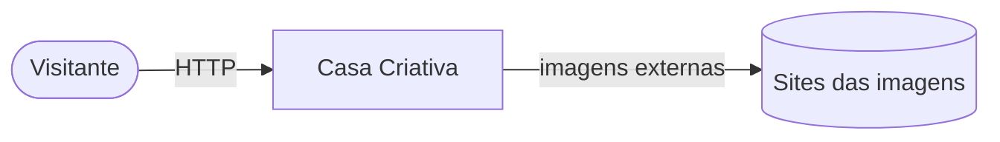
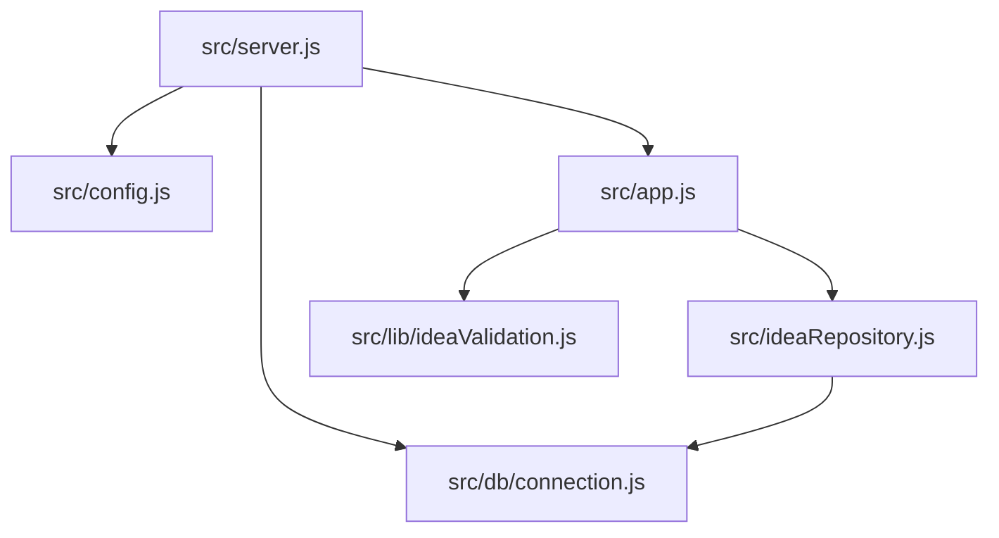

# Arquitetura — Casa Criativa

## 1. C4

### Contexto



### Contêineres

| Contêiner | Tecnologia | Responsabilidade |
|---|---|---|
| Web + API | Node 20, Express 4, Nunjucks (SSR) | Rotas, validação, renderização |
| Banco | SQLite (better-sqlite3), arquivo em `data/` | Ideias |
| Hospedagem | Render Web Service (gratuito) + disco | Execução |

### Componentes



## 2. Pastas

```
src/
├── server.js            ponto de entrada
├── app.js               createApp({ ideas }) — rotas, helmet, rate limit, erros
├── config.js            PORT, DATABASE_FILE, TRUST_PROXY
├── ideaRepository.js    consultas preparadas
├── db/connection.js     migrations (PRAGMA user_version) + seed
└── lib/ideaValidation.js regras de campo e URL http(s)
views/                   Nunjucks (layout, index, ideias, idea-list, modal, error)
public/                  CSS, script do modal, imagens
tests/app.test.js        node:test + supertest
```

## 3. Modelo de dados

| Coluna | Tipo | Regra |
|---|---|---|
| id | INTEGER PK | autoincremento |
| title | TEXT | 3–80 caracteres (CHECK) |
| category | TEXT | 2–40 |
| image | TEXT | URL http(s) (validação na aplicação) |
| description | TEXT | 10–500 |
| link | TEXT | URL http(s) |
| created_at | TEXT | `datetime('now')`, índice com `id` |

## 4. Contratos HTTP

| Rota | Resposta |
|---|---|
| `GET /` | 200 — 2 ideias mais recentes |
| `GET /ideias` | 200 — até 100 ideias; `?criada=1` mostra confirmação |
| `POST /ideias` (também `/`) | 303 → `/ideias?criada=1` · 422 com erros por campo · 429 acima de 10/min |
| `GET /health` | 200 `{ status, ideas }` |
| Outras | 404 página própria · 500 página própria |

## 5. ADRs

- **ADR-001 — better-sqlite3 em vez de sqlite3.** API síncrona e binário pré-compilado; elimina *callbacks* aninhados e a compilação nativa (node-gyp).
- **ADR-002 — Só aceitar URLs `http(s)`.** Fecha o XSS por `javascript:` (OWASP A05). O escape de HTML já vem do `autoescape` do Nunjucks.
- **ADR-003 — PRG (Post/Redirect/Get) com 303.** Evita reenvio ao atualizar a página e permite mostrar a confirmação.
- **ADR-004 — Migração que preserva dados válidos.** `ideas_v2` copia só linhas que passam nas novas regras; o restante é descartado de forma explícita.
- **ADR-005 — Render em vez de Netlify.** Netlify serve sites estáticos/funções; um servidor Express com SQLite precisa de um processo contínuo.

## 6. Fora do escopo

Moderação/remoção de ideias, contas de usuário, busca por categoria, upload de imagem.
